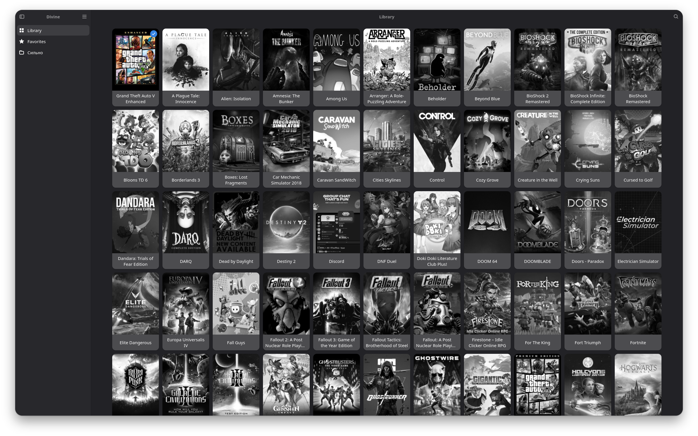
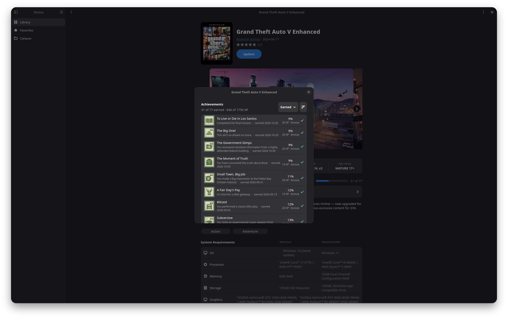
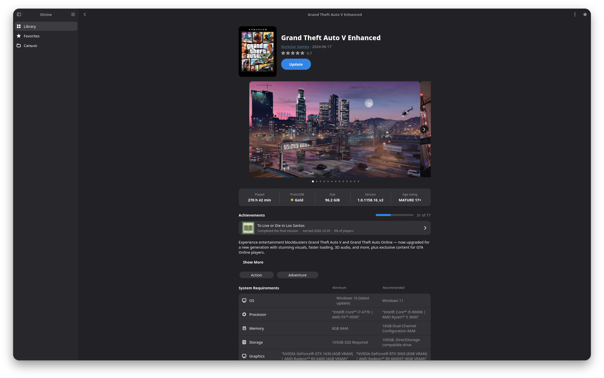
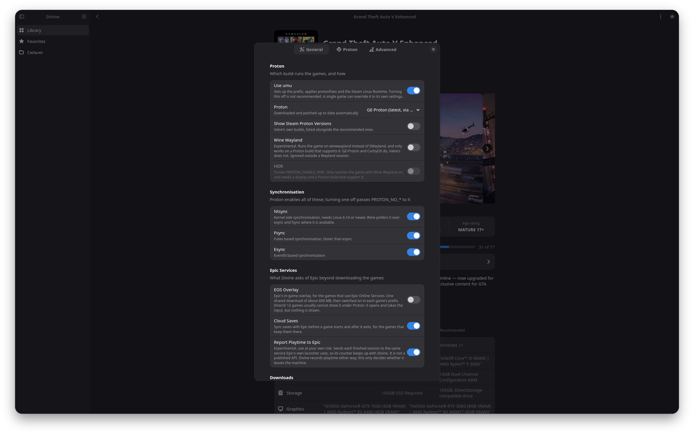

<div align="center">


# Divine

**A native Epic Games launcher for Linux - GTK4 and Rust, built on top of Legendary.**

A real desktop app, not a web page in a window. It opens fast, follows your
theme, and plays your games.



</div>

## Why this exists

Heroic never really worked for me. Stuff broke, stuff hung, and even when it
behaved I didn't enjoy being in it.

I knew what I wanted instead. I like GTK4 and libadwaita, the way the widgets
feel and the fact that an app made of them is open before you've let go of the
mouse. Nobody had built an Epic launcher out of them, so I did.

Divine is a GTK4 app written in Rust, sitting on top of
[Legendary](https://github.com/derrod/legendary), the command-line tool that
already knows how to talk to Epic. Legendary deals with your account, your
library and your downloads. Divine deals with everything you actually look at.

Then it kept growing, because once the basics worked there was room for the
things nobody else had bothered with.

## The things nobody else does

### Your playtime goes back to Epic

This is the big one. Play a game here and the hours land on your Epic account,
the same number you'd see if you had booted Windows. Close Divine while a game
is still running and it still counts.

As far as I know, no other Linux launcher does this.

### Achievements

The real ones from Epic, for the account you're signed in to. What you've
unlocked, what's left, and how rare each one is.

Fewer games have achievements on Epic than on Steam, but more developers add
them every year, and when a game has them you get the full set.



### Collections that are actually your collections

The lists you made in Epic's own launcher, and the star it calls Favorites, show
up in the sidebar and stay in sync. Star something here and it's starred there.
No second set of folders to keep up to date.

### Game pages worth opening

A game page here isn't a title and an install button. You get the store page:
the description, the screenshots, the trailer playing right in the window, tags,
system requirements, links out. Whatever Epic has on a game, it's here.



## Everything else it does

The boring half, which is most of what you actually use:

- **Downloads that behave.** Pause one, come back tomorrow, carry on. There's a
  speed limit too, so a 90 GB patch doesn't hold your evening hostage.
- **Proton, handled.** Install GE-Proton or Proton CachyOS from inside the app
  and keep them updated. One awkward game can have a build of its own.
- **ProtonDB ratings**, so you know what you're in for before the download
  starts.
- **Cloud saves**, up and down.
- **Moving a game to another disk** without downloading it again. Checking its
  files when something's wrong. Removing it when you're done.
- **Games you already have** can be picked up where they are instead of
  downloaded twice, whether you installed them with Heroic, with Legendary, or
  by hand.
- **Per-game settings**, for when one game needs something the rest of your
  library doesn't.
- **A log viewer**, for the evening a game won't start and you need to know
  who's complaining: Divine, Legendary, Proton or the game itself.



## Install

**Arch Linux:** build the package from the PKGBUILD in this repository.

```
git clone https://github.com/NEDOSTUPN0/Divine
cd Divine/packaging/arch
makepkg -si
```

It needs `legendary`, which is in the AUR, so install that first, and
`umu-launcher` from multilib, so multilib has to be enabled in
`/etc/pacman.conf`. If you have Steam, it already is.

**NixOS:** the repository is a flake.

```nix
inputs.divine.url = "github:NEDOSTUPN0/Divine";
# then, wherever your packages are listed:
inputs.divine.packages.${pkgs.system}.default
```

**Anything else:** `cargo build --release`, with GTK 4, libadwaita and GStreamer
installed, and `legendary` and `umu-run` on your `PATH`.

## First run

Divine asks you to sign in to Epic. It opens the page in your browser, you paste
one code back, and that's it. Your library shows up a few seconds later.

Your password never goes near Divine, and the code stops mattering the moment
Legendary trades it for a session.

## Where this is

First public release. It runs my own library every day, but yours will hit
things mine never did. If something breaks, open an issue and say what you did
and what happened.

## Thanks

Before anything else: **[Heroic Games Launcher](https://github.com/Heroic-Games-Launcher/HeroicGamesLauncher)**.

This project starts with me being unhappy with Heroic, so it's only fair to say
how much of it exists because Heroic got there first. How a game actually gets
launched, how Epic expects to be asked, which of a hundred small details
matter: all of that was already answered in their source, in the open, for
anyone to read. I got to start from the answers. Divine wouldn't exist without
them, and if it isn't what you want, go use Heroic. It's good software and they
gave it away.

To be clear about what that means: I read their source, I didn't copy it. There
is no Heroic code in Divine. The one exception is heroic-epic-integration below,
which is a separate project of its own and is used as intended.

The rest of what Divine stands on:

- [Legendary](https://github.com/derrod/legendary), the Epic client underneath
  all of this.
- [umu](https://github.com/Open-Wine-Components/umu-launcher), which makes
  Windows games run properly outside Steam.
- [Cartridges](https://github.com/kra-mo/cartridges), for showing what a GTK4
  game launcher should look like.
- [heroic-epic-integration](https://github.com/Etaash-mathamsetty/heroic-epic-integration),
  the small piece that convinces Epic games they were started by Epic.

## How this was built

Divine was written entirely with Claude Code.

Contributions are welcome from anyone, including people working the same way.
Vibe code if that's how you build things - just read what your agent wrote
before you send it.

## License

GPL-3.0-or-later. See [LICENSE](LICENSE).
